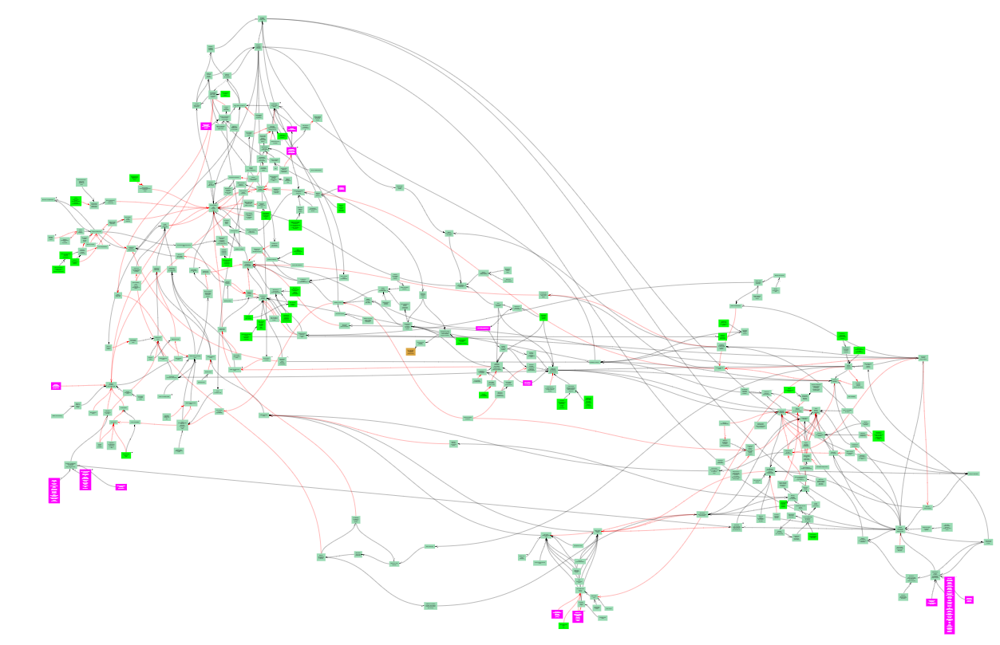

## What is Reproducible Analysis

-   An overall approach to carrying out analysis
-   A set of principles that ensure analysis is:
    -   reproducible
    -   auditable
    -   efficient
    -   high quality

## RAP principles {.smaller}

Project should:

-   Minimise manual steps
-   Be built using open-source software; e.g. R, Python
-   Be peer reviewed by colleagues
-   Be version controlled; e.g. Git
-   Be open to anyone; e.g. code published on GitHub
-   Follow good practice for quality assurance
-   Contain well-commented code and have documentation embedded

## The context {.smaller}

Analysis of a large systems map using RAP {height="500"}

## Copilot in analysis

| RAP          |                                  Copilot |
|--------------|-----------------------------------------:|
| reproducible | [X]{style="color:blue; font-weight:800"} |
| auditable    | [X]{style="color:blue; font-weight:800"} |
| efficient    | [Y]{style="color:blue; font-weight:800"} |
| high quality | [?]{style="color:blue; font-weight:800"} |

## The instruction document {.smaller}

Start with the **instruction document**:

-   The starting point of your planned analysis.
-  Details your intended design
-   Version controlled (e.g. markdown/txt)

## The instruction document - sections {.smaller}

::: incremental
-   Instructions: *"I am conducting ...Please treat this document as the authoritative brief. Before undertaking analysis:"*

    ::: nonincremental
    1.  *Read every file attached with this prompt.*
    2.  *Record all interpretive decisions in an auditable decision log.*
    3.  *Complete only the phase I explicitly authorise. Do not move to later phases without discussion.*
    4.  ..."
    :::

-   Files to attach

-   Purpose and aims: Overall aims and which phase of analysis will be conducted now

-   Context/analytical decisions already made

-   Phases of the analysis: Detail each phase. What has been done. What will be done now. Plans for subsequent steps
:::

## Initial prompt {.smaller}

-   *"See attached. Please await additional files and instructions"*
-   Upload the instruction document and up to a total of three files. Keep uploading relevant files in subsequent prompts
-   *"I have now uploaded all the files. Do you need clarifications before proceeding with the analysis?"*"

::: fragment
**What if the clarifications change the analysis?**
:::

## Auditing changes to analysis {.smaller}

### AI generated analysis instructions

::: incremental
-   *"Please provide a single file that can act as a prompt to enable a new instance of copilot to proceed with all subsequent steps of the analysis. The file should be in Markdown format and follow the structure of \<instruction document.md\>"*
-   Add file to the project/replace original instruction document
-   Review and version control
:::

## Recording the analytical process {.smaller}

::: incremental
-   Save conversation history: *"Produce a single markdown file that records the conversation in terms of my prompts, and your text responses, from either the start of the conversation, or the last time that I prompted you to save the conversation. If files were produced or uploaded in the conversation, these should be named in the markdown file, but do not need to be hyperlinked. Please save the markdown file named with the date and time of the date and time of the first and last prompts saved in the file."*
-   Alternatively a summary: *"Please provide a single downloadable markdown file that summarises the analysis that you conducted to produce the <X output>. Please name all input files used and output files produced."*
-   All saved conversations saved in dedicated project folder
:::

## Copilot in analysis - auditable

| RAP          |                                  Copilot |
|--------------|-----------------------------------------:|
| reproducible | [X]{style="color:blue; font-weight:800"} |
| auditable    | [Y]{style="color:cyan; font-weight:800"} |
| efficient    | [Y]{style="color:blue; font-weight:800"} |
| high quality | [?]{style="color:blue; font-weight:800"} |

## Reproduciblity + Quality {.smaller}

::: incremental
- *"Any code that you use to produce analytical outputs should be saved to Onedrive with a comment in the code specifying the name of the output file it produces.*

- *Code should be well-commented code and have documentation embedded to enable a programmer with a strong foundation in R or Python to understand the code.*

- *R code should follow the tidyverse styleguide."*

- But validation and verification are your responsibility
:::

## Copilot in analysis

| RAP          |                                  Copilot |
|--------------|-----------------------------------------:|
| reproducible | [Y]{style="color:cyan; font-weight:800"} |
| auditable    | [Y]{style="color:cyan; font-weight:800"} |
| efficient    | [Y]{style="color:blue; font-weight:800"} |
| high quality | [Y]{style="color:cyan; font-weight:800"} |

## Other practicalities {.smaller}

::: incremental
-   Think deeper mode (more energy intensive)
-  New instance for each phase: create a phase-specific instruction prompt and upload relevant files (data/code/summaries from previous phases) - energy demand TBD
-   Use copilot personalisation
-   Onedrive:
    -   Copilot cannot (yet) write to Onedrive.
    -   Copilot premium will have access to Onedrive. TBD
:::

## Personalisation {.smaller}

-   Specify coding preferences (language, style, comments)
-   *"When I prompt \"save conversation\" (case insensitive), you should produce a single markdown file that records the conversation in terms of my prompts, and your text responses, from either the start of the conversation, or the last time that I prompted "save conversation". If files were produced or uploaded in the conversation, these should be named in the markdown file, but do not need to be hyperlinked. Please save the markdown file to my OneDrive named with the date and time of the date and time of the first and last prompts saved in the file."*

## Harms and risks {.smaller}

::: incremental
-   Agent based AI has a higher energy demands than chatbots (\~100x)... *"Do I need to use AI for this analysis?"*
-   Each summary/saving request also has (small) environmental footprint (\~0.3 Wh)
-   Assurance of code is your responsibility
:::

#

:::{.r-stack}
**Thoughts, Questions, Discussion**
:::

